Hi, I’m NSPG911!

I'm an 18-year-old student studying in Singapore.

I am proficient in Python, HTML, CSS and JS

I'm currently away from GitHub (hopefully) for the next 1.5 months. I will be back on 17th November.

#### My recently committed repositories!

- [BEComTweaks/resource-packs](https://github.com/BEComTweaks/resource-packs) - A repo containing every single resource pack ported from vanillatweaks.net (1 day ago)
- [BEComTweaks/becomtweaks.github.io](https://github.com/BEComTweaks/becomtweaks.github.io) - Landing Page for the website (1 day ago)
- [BEComTweaks/behaviour-packs](https://github.com/BEComTweaks/behaviour-packs) - A repo containing every single behaviour pack ported from vanillatweaks.net (1 day ago)
- [BEComTweaks/crafting-tweaks](https://github.com/BEComTweaks/crafting-tweaks) - A repo containing every single crafting tweak ported from vanillatweaks.net (1 day ago)
- [NSPC911/rovr](https://github.com/NSPC911/rovr) - a stylish, batteries-included terminal file manager. (1 day ago)

#### My recent Pull Requests!

- [feat: snap to screen](https://github.com/niri-wm/niri/pull/4843) on [niri-wm/niri](https://github.com/niri-wm/niri) (1 day ago)
- [fix: dont force `/`, esp on Windows systems](https://github.com/NSPC911/rovr/pull/385) on [NSPC911/rovr](https://github.com/NSPC911/rovr) (1 day ago)
- [refactor: use backslash on windows](https://github.com/NSPC911/rovr/pull/384) on [NSPC911/rovr](https://github.com/NSPC911/rovr) (4 days ago)

#### You can find me in these places!

  
  
  
  
  

### Mildly useful stats about my account

  
   
  
   
  
  

<image src="https://count.getloli.com/@NSPC911?name=NSPC911&theme=3d-num&padding=7&offset=0&align=top&scale=1&pixelated=0&darkmode=auto" alt="" width=0 height=0 />
